# ariadneDB: a harmonised graph of biological databases and relations

## Introduction

The way that ariadne retrieves and combines relational data is informed
by its companion data package
[ariadneDB](https://github.com/Minotau-R/ariadneDB), which contains
information about the feature types and mappings available from a
handful of popular databases. From here on, we will refer to those
databases as *resources* to distinguish them from the ariadne database
itself.

The relational information of each resource is described by a graph,
where nodes and edges represent feature types and mappings between them,
respectively. In ariadneDB, these graphs are stored in the Graph
Modelling Language (GML), which is a standard format for relational
data. Currently, ariadneDB includes 11 resources that span a diverse set
of biological domains and applications.

| **Resource** | **Description** | **Usage** | **Reference** |
|----|----|----|----|
| [BugSigDB](https://bugsigdb.org) | Literature-based association of signature taxa by phenotype | Link taxa to associated phenotypes | Geistlinger et al. (2024) |
| [ChocoPhlAn](https://huttenhower.sph.harvard.edu/humann) | Pangenome database resulting from the ChocoPhlAn pipeline | Link UniRef gene families to functional information | Franzosa et al. (2018) |
| [Gut Modules (GM)](https://raeslab.org/software/) | Legacy versions of gut metabolic modules and gut brain modules | Link KOs to gut modules | Vieira-Silva et al. (2016); Valles-Colomer et al. (2019) |
| [Gene Ontology (GO)](https://www.geneontology.org/) |  |  | Ashburner et al. (2000) |
| [KEGG](https://www.genome.jp/kegg/) | Metabolic pathway database | Link ko and ec to reactions, pathways and organisms | Kanehisa and Goto (2000) |
| [MSigDB](https://www.gsea-msigdb.org/gsea/msigdb) |  |  | Subramanian et al. (2005) |
| [Open Tree of Life (OTT)](https://opentreeoflife.github.io/) | Synthetic tree of life constructed by combining public phylogenetic trees and taxonomic data | Link different taxonomies and taxon names | Subramanian et al. (2005) |
| [Rhea](https://www.rhea-db.org/) | The reactome database | Link rhea reactions to chebi compounds and external pathways | Bansal et al. (2022) |
| [TIGRFAMs](https://www.ncbi.nlm.nih.gov/refseq/annotation_prok/tigrfams/) |  | Link TIGRFAMs to GO | Haft et al. (2001) |
| [UniProt](https://www.uniprot.org/) | The proteome database | Link UniRef gene families to uniprotkb proteins, NCBI taxa and other external identifiers | Bateman et al. (2025) |
| [Web of Life (WoL)](https://www.web-of-life.es/) | Biological network database | Link UniRef gene families to functional and taxonomic information | Zhu et al. (2019) |

## Tutorial

This tutorial demonstrates how to import and explore the ariadne
resource graph. First, we set up the environment by loading the
necessary dependencies.

\
`# Load required packages`\
[`library`](https://rdrr.io/r/base/library.html)`(`[`ariadne`](https://codeberg.org/Minotau-R/ariadne)`)`\
[`library`](https://rdrr.io/r/base/library.html)`(`[`igraph`](https://r.igraph.org/)`)`\
[`library`](https://rdrr.io/r/base/library.html)`(`[`dplyr`](https://dplyr.tidyverse.org)`)`\
[`library`](https://rdrr.io/r/base/library.html)`(`[`ggplot2`](https://ggplot2.tidyverse.org)`)`\
[`library`](https://rdrr.io/r/base/library.html)`(`[`DT`](https://github.com/rstudio/DT)`)`

When `ariadne` is executed, the graph for each resource is retrieved
from the database release on
[Zenodo](https://zenodo.org/records/18788725) and combined into a single
igraph object.

\
`# Import resource graph`\
`graph`` ``<-`` `[`ariadne`](https://rdrr.io/pkg/ariadne/man/ariadne.html)`(``)`\
\
`# Plot resource graph`\
[`plotPath`](https://rdrr.io/pkg/ariadne/man/plotPath.html)`(``graph``)`\
`#> Using ``"stress"`` as default layout`

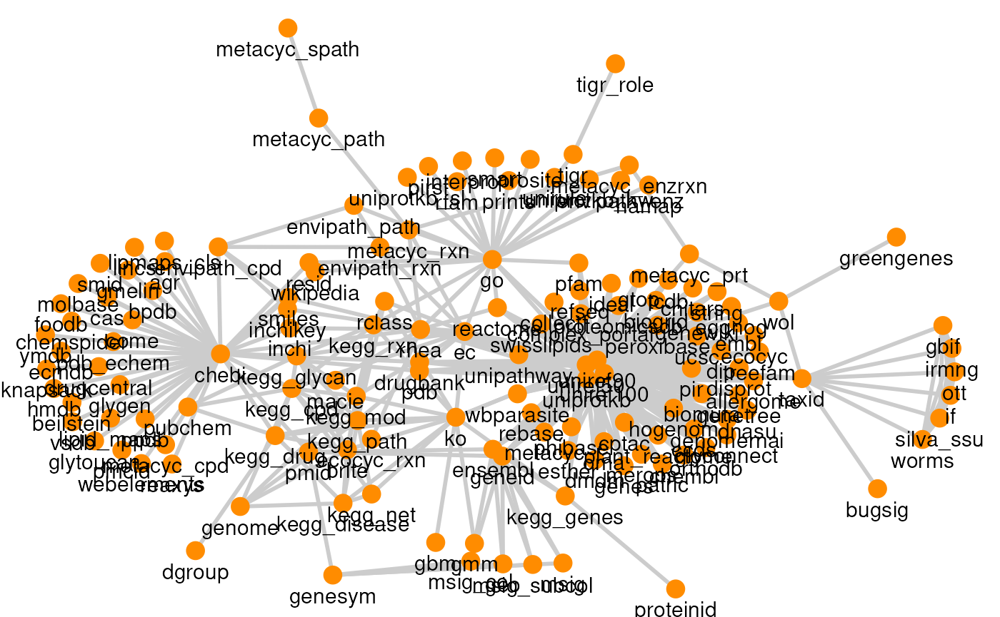

Some resources have multiple versions, which can be selected through the
argument `versions`. This defaults to the latest version found in the
database.

\
`# List available resource versions`\
`versions`` ``<-`` `[`listResourceVersions`](https://rdrr.io/pkg/ariadne/man/listResourceVersions.html)`(``)`\
\
`# View versions`\
[`datatable`](https://rdrr.io/pkg/DT/man/datatable.html)`(``versions``)`

The igraph object is made of two components: edges data and nodes (or
vertices) data, which are stored in two different data tables.

\
`# Convert igraph to data.frame pair`\
`graph_df`` ``<-`` ``igraph``::`[`as_data_frame`](https://r.igraph.org/reference/graph_from_data_frame.html)`(``graph``, what ``=`` ``"both"``)`\
\
`# Extract edges data`\
`edge_df`` ``<-`` ``graph_df``$``edges`\
`# Extract nodes data`\
`node_df`` ``<-`` ``graph_df``$``vertices`

As mentioned above, the resource graph is composed of feature types
(nodes) and mappings (edges) from several resources. We generate the
summary statistics for each resource integrated within ariadne.

\
`# Get stats for each resource`\
`df`` ``<-`` ``edge_df`` ``|>`\
`    `[`group_by`](https://dplyr.tidyverse.org/reference/group_by.html)`(``source``)`` ``|>`\
`    `[`summarise`](https://dplyr.tidyverse.org/reference/summarise.html)`(``edges ``=`` `[`n`](https://dplyr.tidyverse.org/reference/context.html)`(``)``, nodes ``=`` `[`n_distinct`](https://dplyr.tidyverse.org/reference/n_distinct.html)`(`[`c`](https://rdrr.io/r/base/c.html)`(``from``, ``to``)``)``)`\
\
`# View stats`\
[`datatable`](https://rdrr.io/pkg/DT/man/datatable.html)`(``df``)`

The number of edges and nodes represent the amount of links and feature
types provided by each resource, respectively. These two metrics largely
vary between the available resources. The size and graph for each
resource can be visualized by generating individual graphs with the
argument `res.name`.

\
`# Create resource graphs`\
`plots`` ``<-`` `[`lapply`](https://rdrr.io/r/base/lapply.html)`(`\
`    ``df``$``source``, ``function``(``x``)`` ``{`\
`        `[`plotPath`](https://rdrr.io/pkg/ariadne/man/plotPath.html)`(``graph``, res.name ``=`` ``x``, layout ``=`` ``"stress"``, focus ``=`` ``TRUE``)`` ``+`\
`            `[`ggtitle`](https://ggplot2.tidyverse.org/reference/labs.html)`(``x``)`\
`    ``}`\
`)`\
`#> Warning in matrix(c(0, rep(0, dim - 1), 1, rep(0, dim - 2)), 2, dim, byrow =`\
`#> TRUE): data length [3] is not a sub-multiple or multiple of the number of rows`\
`#> [2]`\
\
`# View resource graphs`\
`plots`\
`#> [[1]]`

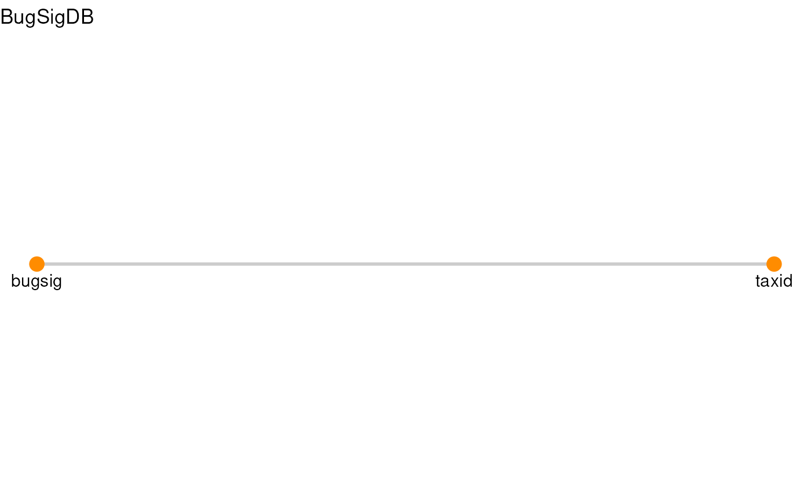

    #> 
    #> [[2]]

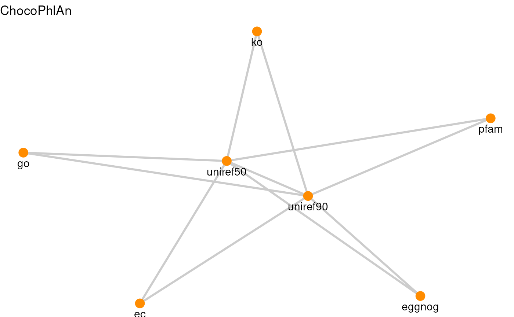

    #> 
    #> [[3]]

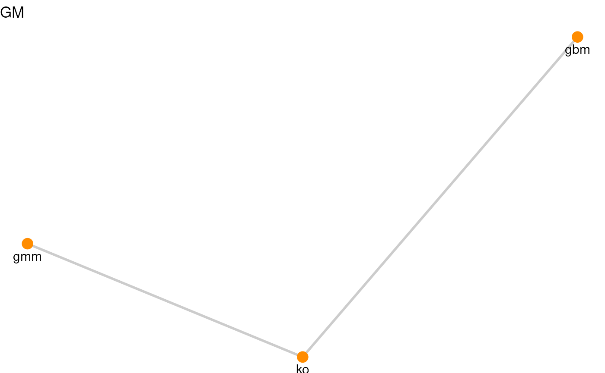

    #> 
    #> [[4]]

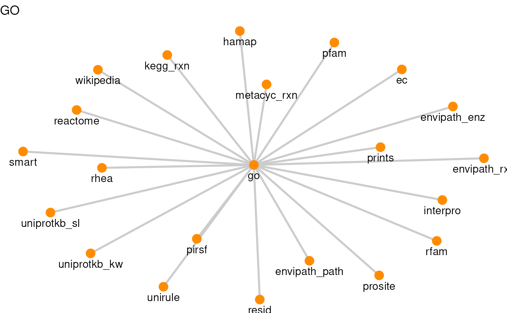

    #> 
    #> [[5]]

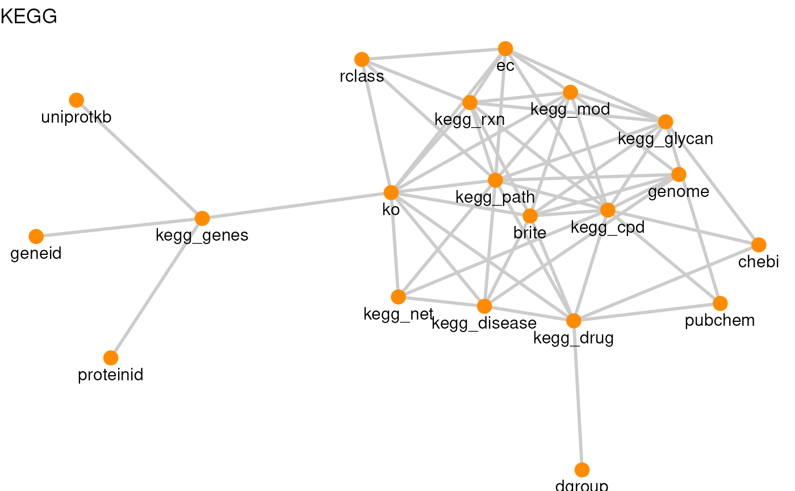

    #> 
    #> [[6]]

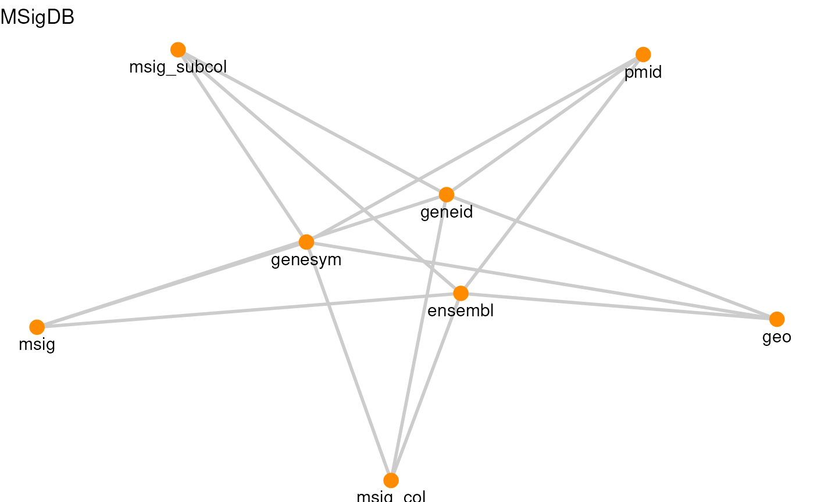

    #> 
    #> [[7]]

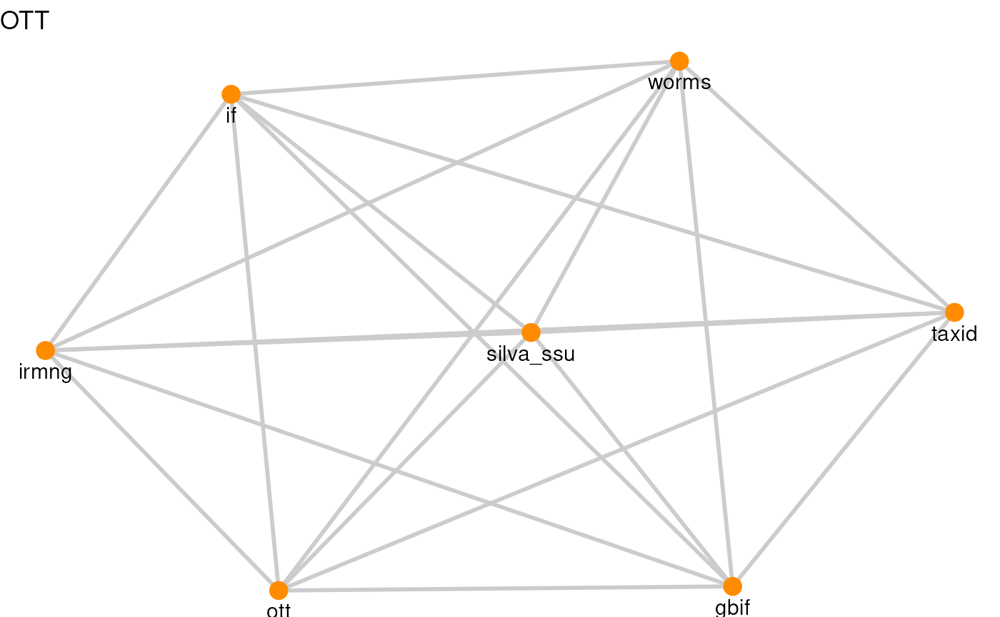

    #> 
    #> [[8]]

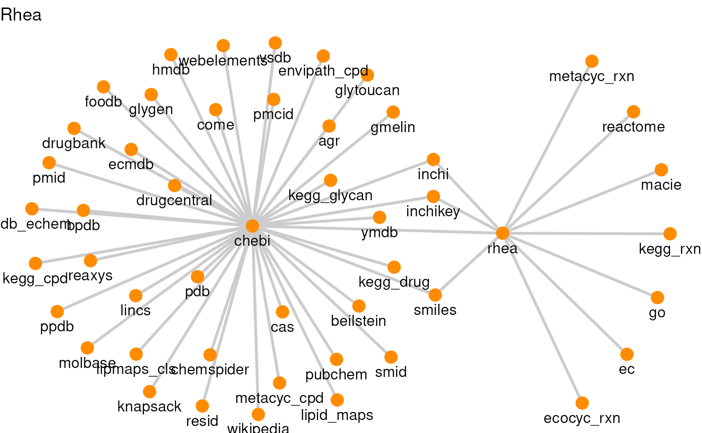

    #> 
    #> [[9]]

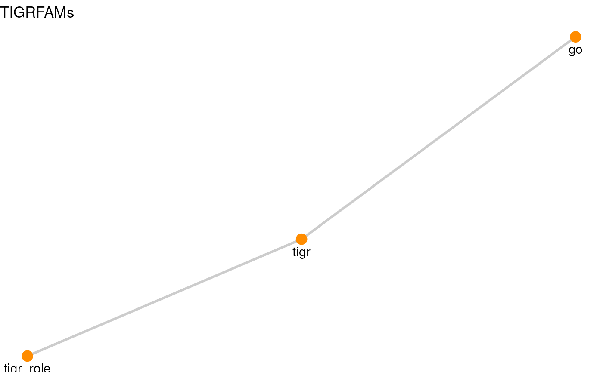

    #> 
    #> [[10]]

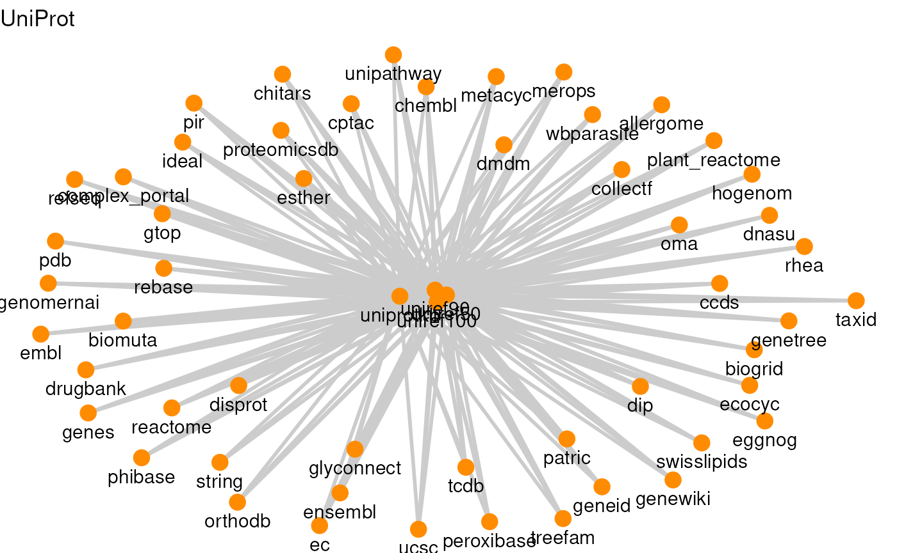

    #> 
    #> [[11]]

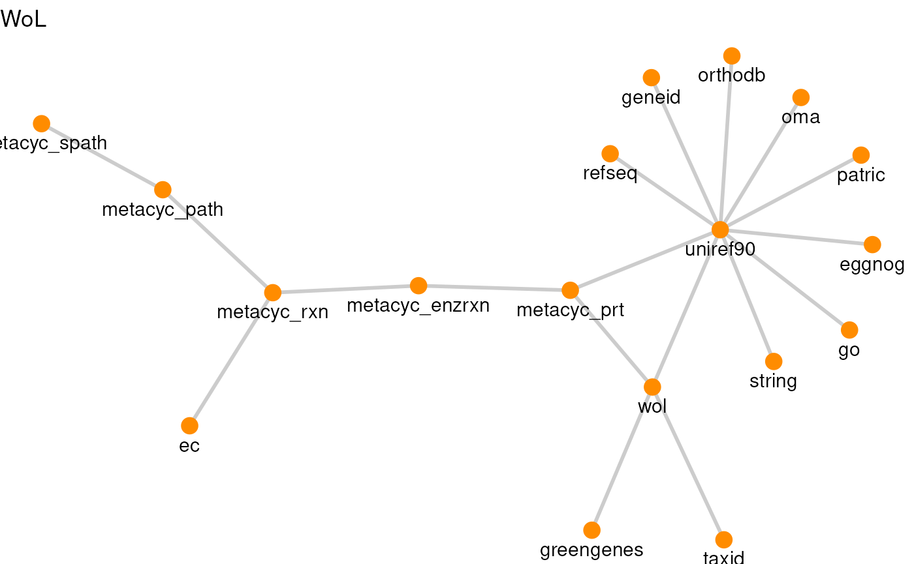

    #> 
    #> [[12]]

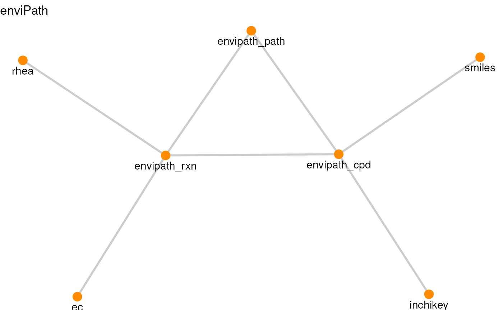

As seen in the graphs, each resource includes unique links between
different feature types, which ariadneDB integrates into a single
organised graph to benefit from its emerging properties.

## Reproducibility

R session information:

    #> R version 4.6.1 (2026-06-24)
    #> Platform: x86_64-pc-linux-gnu
    #> Running under: Ubuntu 24.04.5 LTS
    #> 
    #> Matrix products: default
    #> BLAS:   /usr/lib/x86_64-linux-gnu/openblas-pthread/libblas.so.3 
    #> LAPACK: /usr/lib/x86_64-linux-gnu/openblas-pthread/libopenblasp-r0.3.26.so;  LAPACK version 3.12.0
    #> 
    #> locale:
    #>  [1] LC_CTYPE=en_US.UTF-8       LC_NUMERIC=C               LC_TIME=en_US.UTF-8        LC_COLLATE=en_US.UTF-8    
    #>  [5] LC_MONETARY=en_US.UTF-8    LC_MESSAGES=en_US.UTF-8    LC_PAPER=en_US.UTF-8       LC_NAME=C                 
    #>  [9] LC_ADDRESS=C               LC_TELEPHONE=C             LC_MEASUREMENT=en_US.UTF-8 LC_IDENTIFICATION=C       
    #> 
    #> time zone: UTC
    #> tzcode source: system (glibc)
    #> 
    #> attached base packages:
    #> [1] stats     graphics  grDevices utils     datasets  methods   base     
    #> 
    #> other attached packages:
    #> [1] DT_0.34.0        dplyr_1.2.1      ariadne_0.2.12   igraph_2.3.4     ggraph_2.2.2     ggplot2_4.0.3   
    #> [7] BiocStyle_2.41.0
    #> 
    #> loaded via a namespace (and not attached):
    #>   [1] DBI_1.3.0                   gridExtra_2.3.1             enviPathR_1.0.2             httr2_1.3.0                
    #>   [5] rlang_1.3.0                 magrittr_2.0.5              otel_0.2.0                  matrixStats_1.5.0          
    #>   [9] compiler_4.6.1              RSQLite_3.53.3              png_0.1-9                   systemfonts_1.3.2          
    #>  [13] vctrs_0.7.3                 stringr_1.6.0               pkgconfig_2.0.3             crayon_1.5.3               
    #>  [17] fastmap_1.2.0               dbplyr_2.6.0                XVector_0.53.0              labeling_0.4.3             
    #>  [21] rmarkdown_2.32              tzdb_0.5.0                  ragg_1.5.2                  purrr_1.2.2                
    #>  [25] bit_4.6.0                   xfun_0.62                   cachem_1.1.0                jsonlite_2.0.0             
    #>  [29] progress_1.2.3              blob_1.3.0                  DelayedArray_0.39.8         BiocParallel_1.47.0        
    #>  [33] tweenr_2.0.3                prettyunits_1.2.0           parallel_4.6.1              R6_2.6.1                   
    #>  [37] bslib_0.12.0                stringi_1.8.9               RColorBrewer_1.1-3          GenomicRanges_1.65.4       
    #>  [41] jquerylib_0.1.4             Rcpp_1.1.2                  Seqinfo_1.3.2               bookdown_0.48              
    #>  [45] assertthat_0.2.1            SummarizedExperiment_1.43.0 knitr_1.52                  readr_2.2.0                
    #>  [49] IRanges_2.47.5              rentrez_1.2.4               rotl_3.1.1                  Matrix_1.7-6               
    #>  [53] tidyselect_1.2.1            abind_1.4-8                 yaml_2.3.12                 viridis_0.6.5              
    #>  [57] codetools_0.2-20            curl_8.1.0                  lattice_0.23-1              tibble_3.3.1               
    #>  [61] Biobase_2.73.2              withr_3.0.3                 KEGGREST_1.53.6             S7_0.2.2                   
    #>  [65] evaluate_1.0.5              desc_1.4.3                  polyclip_1.10-7             BiocFileCache_3.3.2        
    #>  [69] Biostrings_2.81.9           pillar_1.11.1               BiocManager_1.30.27         filelock_1.0.3             
    #>  [73] MatrixGenerics_1.25.0       stats4_4.6.1                generics_0.1.4              S4Vectors_0.51.10          
    #>  [77] hms_1.1.4                   scales_1.4.0                rncl_0.8.10                 glue_1.8.1                 
    #>  [81] tools_4.6.1                 data.table_1.18.6.1         forcats_1.0.1               XML_3.99-0.25              
    #>  [85] fs_2.1.0                    graphlayouts_1.2.5          multifactor_0.1.3           tidygraph_1.3.1            
    #>  [89] grid_4.6.1                  ape_5.8-1                   tidyr_1.3.2                 crosstalk_1.2.2            
    #>  [93] nlme_3.1-171                ggforce_0.5.0               cli_3.6.6                   textshaping_1.0.5          
    #>  [97] S4Arrays_1.13.2             viridisLite_0.4.3           arrow_26.0.0                gtable_0.3.6               
    #> [101] sass_0.4.10                 digest_0.6.39               BiocGenerics_0.59.12        SparseArray_1.13.4         
    #> [105] ggrepel_0.9.8               htmlwidgets_1.6.4           farver_2.1.2                memoise_2.0.1              
    #> [109] htmltools_0.5.9             pkgdown_2.2.1               lifecycle_1.0.5             httr_1.4.9                 
    #> [113] bit64_4.8.6                 MASS_7.3-66

## References

Ashburner, Michael, Catherine A Ball, Judith A Blake, et al. 2000. “Gene
Ontology: Tool for the Unification of Biology.” *Nature Genetics* 25
(1): 25–29.

Bansal, Parit, Anne Morgat, Kristian B Axelsen, et al. 2022. “Rhea, the
Reaction Knowledgebase in 2022.” *Nucleic Acids Research* 50 (D1):
D693–700.

Bateman, Alex, Maria-Jesus Martin, Sandra Orchard, et al. 2025.
“UniProt: The Universal Protein Knowledgebase in 2025.” *Nucleic Acids
Research* 53 (D1).

Franzosa, Eric A, Lauren J McIver, Gholamali Rahnavard, et al. 2018.
“Species-Level Functional Profiling of Metagenomes and
Metatranscriptomes.” *Nature Methods* 15 (11): 962–68.

Geistlinger, Ludwig, Chloe Mirzayi, Fatima Zohra, et al. 2024. “BugSigDB
Captures Patterns of Differential Abundance across a Broad Range of
Host-Associated Microbial Signatures.” *Nature Biotechnology* 42 (5):
790–802.

Haft, Daniel H, Brendan J Loftus, Delwood L Richardson, et al. 2001.
“TIGRFAMs: A Protein Family Resource for the Functional Identification
of Proteins.” *Nucleic Acids Research* 29 (1): 41–43.

Kanehisa, Minoru, and Susumu Goto. 2000. “KEGG: Kyoto Encyclopedia of
Genes and Genomes.” *Nucleic Acids Research* 28 (1): 27–30.

Subramanian, Aravind, Pablo Tamayo, Vamsi K Mootha, et al. 2005. “Gene
Set Enrichment Analysis: A Knowledge-Based Approach for Interpreting
Genome-Wide Expression Profiles.” *Proceedings of the National Academy
of Sciences* 102 (43): 15545–50.

Valles-Colomer, Mireia, Gwen Falony, Youssef Darzi, et al. 2019. “The
Neuroactive Potential of the Human Gut Microbiota in Quality of Life and
Depression.” *Nature Microbiology* 4 (4): 623–32.

Vieira-Silva, Sara, Gwen Falony, Youssef Darzi, et al. 2016.
“Species–Function Relationships Shape Ecological Properties of the Human
Gut Microbiome.” *Nature Microbiology* 1 (8): 16088.

Zhu, Qiyun, Uyen Mai, Wayne Pfeiffer, et al. 2019. “Phylogenomics of
10,575 Genomes Reveals Evolutionary Proximity between Domains Bacteria
and Archaea.” *Nature Communications* 10 (1): 5477.
